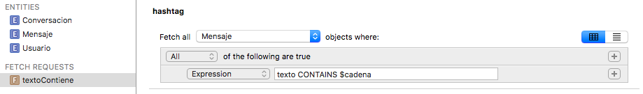

Hasta ahora solo hemos creado *fetch requests* que devuelven todas las instancias de una entidad, lo que sería el equivalente a un `SELECT` sin `WHERE` en SQL. Para filtrar los resultados usaremos **predicados**, que en el API se representan con la clase `NSPredicate`.

Seguiremos usando como ejemplo el modelo de la aplicación de mensajería de la sesión anterior (`Usuario`, `Mensaje` y `Conversacion`).

> En los ejemplos de las dos primeras secciones ejecutaremos las *fetch requests* con el método `fetch` del contexto, para centrarnos en cómo se escriben las consultas. Suponemos que `miContexto` es el contexto de persistencia (el `viewContext`, que en una vista obtenemos del entorno con `@Environment(\.managedObjectContext)`). En la tercera sección veremos cómo usar todo esto en las vistas, con `@FetchRequest`.

## Un primer ejemplo

Para obtener los mensajes que contienen el texto "iOS":

```swift
let request: NSFetchRequest<Mensaje> = Mensaje.fetchRequest()
request.predicate = NSPredicate(format: "texto CONTAINS 'iOS'")
let resultados = try miContexto.fetch(request)
print("Hay \(resultados.count) resultados")
for mensaje in resultados {
    print(mensaje.texto ?? "")
}
```

Como vemos, la única diferencia con lo que hacíamos hasta ahora es que creamos un `NSPredicate` con la condición a cumplir y lo asignamos a la propiedad `predicate` de la *fetch request*.

La condición se escribe como una cadena con una sintaxis propia, parecida a la de la cláusula `WHERE` de SQL. El inconveniente es que la cadena se interpreta en tiempo de ejecución, así que los errores de sintaxis (o un nombre de atributo mal escrito) no los vamos a detectar al compilar, sino cuando la app se cierre al ejecutar la consulta. Es algo muy similar a lo que ocurre cuando escribimos sentencias SQL en nuestro código.

> Los predicados no son exclusivos de Core Data: son un mecanismo general de Foundation, que también se usa por ejemplo para buscar con *Spotlight*. Para filtrar arrays en memoria, sin embargo, en Swift es más cómodo usar el método `filter`.

## Operadores

Los predicados aceptan diversos tipos de operadores:

- **Comparación**: `==` (o `=`), `!=`, `<`, `>`, `<=`, `>=`, y también `BETWEEN` (`creditos BETWEEN {10, 100}`) e `IN` (`login IN {'pepe', 'eva'}`).
- **Lógicos**: `AND`, `OR`, `NOT` (o al estilo C, `&&`, `||`, `!`). Podemos usar paréntesis para agrupar.
- **Comparación de cadenas**:
    - `BEGINSWITH`, `ENDSWITH`, `CONTAINS`
    - `LIKE`: compara con un patrón que admite comodines (`?` para un carácter y `*` para cualquier número de caracteres)
    - `MATCHES`: comprueba si la cadena encaja con una expresión regular en [formato ICU](https://unicode-org.github.io/icu/userguide/strings/regexp.html)

Los operadores de cadenas distinguen por defecto entre mayúsculas/minúsculas y entre símbolos diacríticos (acentos, diéresis, etc). Poniendo `[c]` detrás del operador no se distinguen mayúsculas de minúsculas, con `[d]` no se distinguen los diacríticos, y con `[cd]` ninguna de las dos cosas. Por ejemplo

```
texto CONTAINS[cd] 'cancion'
```

encajaría con "Canción", "CANCIONES", "una canción",...

> En una app en castellano casi siempre querremos usar `[cd]` en las búsquedas de texto: el usuario no espera que "camion" no encuentre "camión".

Podéis consultar la referencia completa de la sintaxis en el apartado “[Predicate Format String Syntax](https://developer.apple.com/library/archive/documentation/Cocoa/Conceptual/Predicates/Articles/pSyntax.html)” de la “[Predicate Programming Guide](https://developer.apple.com/library/archive/documentation/Cocoa/Conceptual/Predicates/AdditionalChapters/Introduction.html)” de Apple. Es documentación antigua (archivada) pero sigue siendo válida.

## Parámetros

Lo habitual es que los valores de la consulta no sean fijos sino que vengan de variables (por ejemplo, de lo que ha escrito el usuario). Para ello en la cadena del predicado se usan **caracteres de formato**, al estilo del `printf` de C, y se le pasan los valores en un array:

```swift
let haceUnaSemana = Date(timeIntervalSinceNow: -7*24*60*60)
let pred = NSPredicate(format: "texto CONTAINS[cd] %@ AND fecha > %@",
                       argumentArray: ["iOS", haceUnaSemana])
```

El carácter de formato `%@` representa un valor, y se sustituye por el elemento correspondiente del array. Lo podemos usar con cualquier tipo de valor: cadenas, números, fechas... e incluso, como veremos luego, objetos gestionados por Core Data.

!!! warning "No construyas el predicado concatenando cadenas"
    Podríamos estar tentados de meter los valores directamente en la cadena del predicado con la interpolación de Swift:

    ```swift
    //¡MAL!
    NSPredicate(format: "texto CONTAINS[cd] '\(textoBuscado)'")
    ```

    Esto funcionará en las primeras pruebas, pero en cuanto el texto contenga una comilla (por ejemplo, "l'Alcúdia") el predicado tendrá un error de sintaxis y la app se cerrará. Es el mismo problema que la *inyección SQL*. Con `%@` el valor se inserta correctamente sea cual sea su contenido, así que **siempre** usaremos caracteres de formato para los valores.

Las cadenas que se insertan con `%@` se ponen automáticamente entre comillas, como deben ir los valores. Pero esto no es lo que queremos si lo que queremos parametrizar es el **nombre de un atributo**. Por ejemplo, el siguiente código

```swift
let atributo = "login"
let subcadena = "pep"
let pred = NSPredicate(format: "%@ CONTAINS[c] %@", argumentArray: [atributo, subcadena])
```

generaría el predicado

```
"login" CONTAINS[c] "pep"
```

que no es lo que buscamos, ya que compara dos cadenas constantes en lugar de comparar el valor del atributo `login`. Para los nombres de atributos se usa el carácter de formato `%K`, que no pone comillas. La versión correcta sería

```swift
let pred = NSPredicate(format: "%K CONTAINS[c] %@", argumentArray: [atributo, subcadena])
```

> Un truco útil para que el compilador compruebe los nombres de los atributos es usar `#keyPath` junto con `%K`: `NSPredicate(format: "%K CONTAINS[c] %@", #keyPath(Usuario.login), subcadena)`. Si nos equivocamos al escribir el nombre del atributo, el código no compilará.

## Predicados sobre relaciones

En los predicados podemos incluir no solo los atributos “simples”, sino también las relaciones entre objetos.

Buscar en una relación “a uno” es prácticamente igual que buscar en un atributo: basta con seguir la relación con un punto. Por ejemplo, para buscar los mensajes enviados por usuarios cuyo login comience por "m":

```swift
let pred = NSPredicate(format: "usuario.login BEGINSWITH[c] 'm'")
```

También podemos comparar directamente con un objeto gestionado. Por ejemplo, para obtener los mensajes de un usuario `u` que contengan un determinado texto:

```swift
let pred = NSPredicate(format: "usuario == %@ AND texto CONTAINS[cd] %@",
                       argumentArray: [u, "fiesta"])
```

Buscar en una relación “a muchos” es ligeramente más complicado, ya que estamos buscando en una colección:

- Con `ANY` comprobamos que algún elemento de la colección cumpla la condición. Por ejemplo, para buscar los usuarios que participan en alguna conversación que haya empezado en la última hora:

```swift
let haceUnaHora = Date(timeIntervalSinceNow: -60*60)
let pred = NSPredicate(format: "ANY conversaciones.comienzo > %@", argumentArray: [haceUnaHora])
```

- Con `ALL` comprobamos que la cumplan todos, y con `NONE` que no la cumpla ninguno.
- Con `@count` obtenemos el número de elementos de la colección. Por ejemplo, para buscar las conversaciones con más de 10 mensajes:

```swift
let pred = NSPredicate(format: "mensajes.@count > 10")
```

## Qué no se puede usar en un predicado

Cuando usamos el almacenamiento SQLite (que es lo habitual), Core Data traduce el predicado a SQL y la consulta la ejecuta la base de datos. Por eso **en un predicado solo podemos usar atributos y relaciones definidos en el modelo de datos**. No podemos usar propiedades calculadas que hayamos añadido en una extensión de la clase (como la `numMensajes` del `Usuario` de la sesión anterior), ni atributos `Transient`, ya que no existen en la base de datos. Si lo intentamos, la consulta lanzará un error en tiempo de ejecución.

## Otras opciones de las *fetch requests*

Además del predicado, una *fetch request* tiene otras propiedades útiles:

- `fetchLimit`: número máximo de resultados que queremos obtener. Por ejemplo, para quedarnos con los 20 mensajes más recientes (combinado con la ordenación que veremos en la siguiente sección).
- `fetchOffset`: número de resultados que nos saltamos al principio. Junto con `fetchLimit` sirve para hacer paginación.

Y si solo nos interesa **cuántos** objetos cumplen una condición, no hace falta recuperarlos: el contexto puede contarlos directamente en la base de datos, lo que es mucho más eficiente.

```swift
let request: NSFetchRequest<Mensaje> = Mensaje.fetchRequest()
request.predicate = NSPredicate(format: "usuario == %@", argumentArray: [u])
let total = try miContexto.count(for: request)
```

## Otras formas de crear predicados

!!! info "Nota"
    Este apartado es de ampliación. No lo necesitarás para los ejercicios.

Además de con cadenas, los predicados se pueden crear de otras dos formas:

- Con **templates**, que son predicados en forma de cadena que incluyen *variables* con nombre, precedidas de `$`, algo así como los parámetros con nombre de las consultas SQL. Se pueden crear por código o, en Core Data, como *fetch requests* predefinidas en el editor del modelo de datos (manteniendo pulsado el botón `Add Entity` y eligiendo `Add Fetch Request`).
- **Directamente en código**, con clases que representan las partes del predicado: `NSComparisonPredicate` para las comparaciones, `NSCompoundPredicate` para combinar predicados con `AND`/`OR`, `NSExpression` para los valores... Es una forma de trabajar engorrosa, pero útil cuando queremos construir la consulta dinámicamente. `NSCompoundPredicate` en concreto es bastante práctico para combinar predicados que hemos creado por separado:

```swift
let porTexto = NSPredicate(format: "texto CONTAINS[cd] %@", argumentArray: ["iOS"])
let porUsuario = NSPredicate(format: "usuario == %@", argumentArray: [u])
request.predicate = NSCompoundPredicate(andPredicateWithSubpredicates: [porTexto, porUsuario])
```

Para ejecutar una *fetch request* predefinida en el editor, la recuperamos por nombre del modelo de datos, pasándole un diccionario con el valor de cada variable. Por ejemplo, para una *template* llamada `textoContiene` con el predicado `texto CONTAINS[cd] $cadena`:

```swift
let miModelo = PersistenceController.shared.container.managedObjectModel
if let request = miModelo.fetchRequestFromTemplate(withName: "textoContiene",
                                                   substitutionVariables: ["cadena": "iOS"]) {
    let resultados = try miContexto.fetch(request) as! [Mensaje]
    print("Hay \(resultados.count) resultados")
}
```



> Para escribir predicados con variables es mejor usar el editor de *templates* en modo texto, que se activa con el segundo de los botones de la parte superior derecha del editor. El modo visual puede poner comillas alrededor de la variable (`texto CONTAINS "$cadena"`), y entonces no se reconoce como variable sino como un texto literal.
