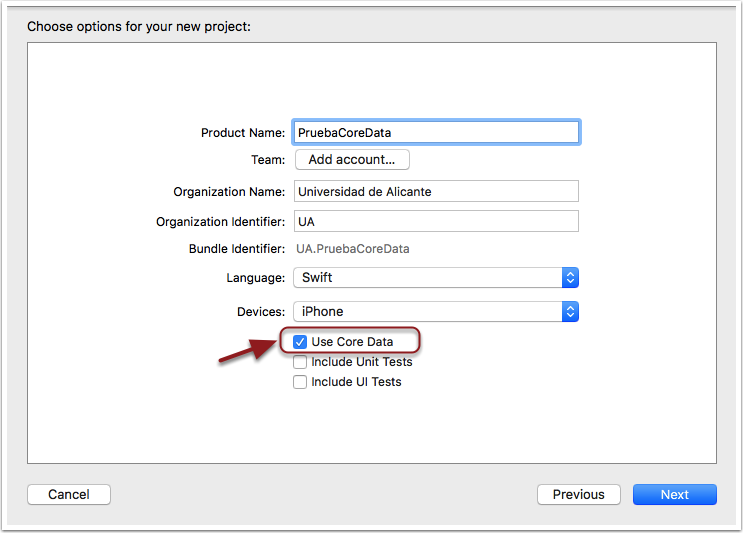

Vamos a introducir las funcionalidades básicas de Core Data implementando una pequeña aplicación para almacenar y listar notas de texto.

Lo primero que necesitamos para poder trabajar con Core Data es inicializar su *stack*, es decir instanciar las clases y crear los archivos de configuración necesarios para poder almacenar y recuperar objetos persistentes. 

Salvo que tengamos necesidades especiales no es necesario escribir el código de inicialización manualmente, Xcode lo puede hacer por nosotros. Para ello, al crear el proyecto hay que elegir Core Data como opción de almacenamiento en la segunda pantalla del asistente, tras elegir la plantilla. 

**Crea un nuevo proyecto `NotasCoreData`** usando como plantilla `iOS > App`. En la segunda pantalla del asistente **selecciona `Interface: SwiftUI`, `Language: Swift` y en `Storage` elige `Core Data`**. Deja desmarcada la casilla `Host in CloudKit`.



Elegir Core Data como almacenamiento tiene los siguientes efectos:

- Crea un archivo con el mismo nombre del proyecto y extensión `.xcdatamodeld` donde se va a almacenar nuestro modelo de datos. Como ejemplo, Xcode crea en él una entidad llamada `Item`.
- Crea un archivo `Persistence.swift` con el código que inicializa Core Data.
- Modifica la estructura principal de la app para que todas las vistas tengan acceso a Core Data.
- Genera un `ContentView` de ejemplo que muestra una lista de objetos `Item`.

El modelo de ejemplo y el `ContentView` los sustituiremos por los nuestros en la siguiente sección. Vamos a ver ahora el código de inicialización, que es el que nos interesa.

## El `PersistenceController`

Reconociendo que la inicialización del *stack* era laboriosa, desde iOS 10 Apple la ha encapsulado en una clase `NSPersistentContainer` que simplifica considerablemente el código. En el archivo `Persistence.swift` la plantilla define una estructura `PersistenceController` que crea y guarda el `NSPersistentContainer`. Este es su código principal (sin los comentarios):

```swift
import CoreData

struct PersistenceController {
    //instancia compartida, la que usa la app
    static let shared = PersistenceController()

    let container: NSPersistentContainer

    init(inMemory: Bool = false) {
        container = NSPersistentContainer(name: "NotasCoreData")
        if inMemory {
            container.persistentStoreDescriptions.first!.url = URL(fileURLWithPath: "/dev/null")
        }
        container.loadPersistentStores(completionHandler: { (storeDescription, error) in
            if let error = error as NSError? {
                fatalError("Unresolved error \(error), \(error.userInfo)")
            }
        })
        container.viewContext.automaticallyMergesChangesFromParent = true
    }
}
```

Veamos qué hace:

- Crea un `NSPersistentContainer`. **El nombre que se le pasa debe coincidir con el del archivo `.xcdatamodeld`** (sin la extensión). Si lo renombras, tendrás que cambiarlo también aquí. Ese mismo nombre se usa para el archivo de la base de datos (`NotasCoreData.sqlite`).
- Con `loadPersistentStores` abre la base de datos, o la crea si no existe. Si hay algún error la app termina inmediatamente con `fatalError`. Es útil durante el desarrollo, pero los comentarios de la propia plantilla advierten de que en una aplicación real deberíamos gestionar el error de otra forma.
- Si se crea con `inMemory: true`, la base de datos no se guarda en disco (`/dev/null` es un "archivo" que descarta todo lo que se escribe en él). Lo usaremos para las *previews*, como veremos enseguida.
- La última línea la explicaremos en la sesión de concurrencia.

El `NSPersistentContainer` centraliza todo el manejo de Core Data. Nos da acceso al `NSManagedObjectContext` mediante su propiedad `viewContext`. Esto, que es lo que se denomina el contexto de persistencia, es lo que necesitaremos para guardar y recuperar objetos. El `viewContext` está asociado al hilo principal, por lo que es el que usaremos desde las vistas.

> A diferencia de otras plantillas de Xcode, la de SwiftUI no guarda automáticamente los cambios en ningún momento: **cada vez que hagamos cambios tendremos que guardar nosotros el contexto**, como veremos en la siguiente sección.

## El contexto en las vistas

Las vistas necesitan acceder al contexto para crear, modificar o consultar objetos. En lugar de pasárselo de una vista a otra, la plantilla lo coloca en el **entorno** de la app, en la estructura principal:

```swift
@main
struct NotasCoreDataApp: App {
    let persistenceController = PersistenceController.shared

    var body: some Scene {
        WindowGroup {
            ContentView()
                .environment(\.managedObjectContext, persistenceController.container.viewContext)
        }
    }
}
```

Y cualquier vista que lo necesite lo obtiene del entorno así:

```swift
struct MiVista: View {
    @Environment(\.managedObjectContext) private var contexto

    var body: some View {
        //...aquí podemos usar "contexto"
    }
}
```

!!! note "Nuevo en SwiftUI: el entorno"
    El **entorno** (*environment*) es un conjunto de valores que SwiftUI pone a disposición de una vista y de todas las vistas que contiene, sin necesidad de pasarlos como parámetro de una a otra. El sistema ya coloca ahí muchos valores, como el modo claro u oscuro (`\.colorScheme`) o el idioma (`\.locale`), y con el modificador `.environment` podemos añadir o cambiar valores para una vista y todas las que contiene. Para leer un valor del entorno, una vista declara una propiedad con `@Environment` y la clave del valor que quiere.

    Como en la estructura principal se ha puesto el contexto en el entorno de `ContentView`, todas las vistas de la app, que están dentro de ella, pueden obtenerlo.

## Core Data en las *previews*

Las *previews* no pasan por la estructura principal de la app, así que el contexto no está en el entorno, y una vista que use Core Data hará que la *preview* falle. Por eso hay que ponerlo también en la *preview*. Para no mezclar los datos de prueba con los de la app, la plantilla define en `PersistenceController` una segunda instancia, `preview`, que crea la base de datos en memoria y le añade algunos objetos de ejemplo:

```swift
static var preview: PersistenceController = {
    let result = PersistenceController(inMemory: true)
    let viewContext = result.container.viewContext
    //aquí se crean los objetos de ejemplo
    //...
    return result
}()
```

Así, en la *preview* de una vista que use Core Data haremos:

```swift
#Preview {
    MiVista()
        .environment(\.managedObjectContext, PersistenceController.preview.container.viewContext)
}
```

> También puedes añadir soporte de Core Data a un proyecto ya creado, aunque no lo crearas eligiendo Core Data en el asistente. Se trata de añadir manualmente el fichero del modelo de datos (`File > New > File...`, plantilla `Data Model`), un archivo como `Persistence.swift` y la línea `.environment(...)` de la estructura principal.
