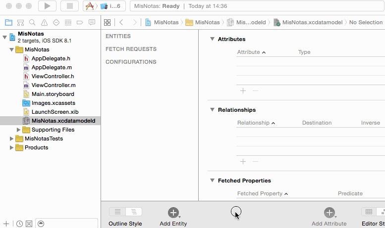

!!! info "Ejercicios"
    Esta sección es un ejercicio a seguir paso a paso que vale **0.5 puntos** de la nota del bloque de iOS

## Crear las entidades (0.25 puntos)

Las entidades son los objetos que queremos hacer persistentes en nuestra aplicación. Debemos especificar sus propiedades (nombre y tipo) y como veremos en sesiones posteriores podemos establecer relaciones con otros objetos.

Para gestionar las entidades debemos editar el archivo `.xcdatamodeld`. En el editor visual de Xcode podemos, entre otras cosas, añadir y eliminar entidades. Vamos a eliminar la entidad de ejemplo y crear la única entidad que necesitamos en nuestra aplicación: `Nota`. Para ello seguir estos pasos:

1. **Abrir el modelo de datos**: por defecto Xcode lo crea con el mismo nombre que el proyecto y extensión `.xcdatamodeld`. 
2. **Eliminar la entidad `Item`**: seleccionarla y pulsar la tecla de borrar.
3. **Añadir una entidad** pulsando el botón `Add Entity` de la parte inferior. Creará una nueva entidad llamada por defecto `Entity`. Podemos cambiarle el nombre haciendo doble clic sobre él. **Cambiarle el nombre a la entidad** a `Nota` 
4. **Añadir los atributos** pulsando sobre el botón `+` de la sección `Attributes`. Para cada atributo hay que especificar su nombre y tipo. Añadiremos dos atributos, `fecha`, de tipo `Date` y `texto` de tipo `String`

> IMPORTANTE: Los nombres de las entidades deben comenzar por mayúscula y los nombres de los atributos por minúscula. El editor no nos dejará hacer lo contrario.



Selecciona la entidad `Nota` en el editor y selecciona el `Data Model Inspector` en el panel de la derecha de Xcode (el último icono de la barra superior del panel ). En el apartado `Class` verás los datos de la clase Swift que Xcode va a autogenerar para representar a tu entidad. 

Por defecto:

 - El nombre es el mismo que la entidad
 - En `Module` aparece `Global namespace`, lo que quiere decir que la clase no se asocia a ningún módulo en concreto. No te preocupes por esto, puedes usarla en tu código sin más.
 - En el campo `Codegen` debería aparecer seleccionado `Class Definition`, ese es el método que usa Xcode para generar el código, lo veremos con más detalle en la siguiente sesión. Con esta opción la clase se genera automáticamente al compilar y **no** aparece como archivo en el proyecto, así que no la busques en el navegador de archivos.

> Para terminar, asegúrate de guardar el modelo (`File > Save`). Hay veces que no se genera la clase Swift correspondiente a la entidad si no se hace esto

### Adaptar el código de la plantilla

Como hemos eliminado la entidad `Item`, el código de ejemplo que la usaba ya no compila. Vamos a sustituirlo.

- En `Persistence.swift`, dentro de `static var preview`, Xcode crea 10 objetos `Item` de ejemplo con un bucle `for`. Sustituye ese bucle por este otro, que crea 5 notas de ejemplo para las *previews*:

```swift
for i in 1...5 {
    let nota = Nota(context: viewContext)
    nota.texto = "Nota de ejemplo \(i)"
    nota.fecha = Date()
}
```

- La aplicación tendrá dos pestañas: una para crear notas y otra para listarlas. Sustituye el contenido de `ContentView.swift` por el siguiente:

```swift
import SwiftUI

struct ContentView: View {
    var body: some View {
        TabView {
            NuevaNotaView()
                .tabItem { Label("Nueva", systemImage: "square.and.pencil") }
            ListaNotasView()
                .tabItem { Label("Lista", systemImage: "list.bullet") }
        }
    }
}

#Preview {
    ContentView()
        .environment(\.managedObjectContext, PersistenceController.preview.container.viewContext)
}
```

- Crea dos archivos nuevos (`File > New > File... > SwiftUI View`), `NuevaNotaView.swift` y `ListaNotasView.swift`. De momento basta con el contenido que genera Xcode; la lista la haremos en la siguiente sección.

> Si Xcode da error y no reconoce la clase `Nota` puedes probar a recompilar el proyecto con `Product > Clean Build Folder` (`Shift+Cmd+K`) y luego `Product > Build` (`Cmd+B`). A veces se genera el código para `Nota` pero no se compila o a veces no se ha generado. También ayuda a veces ir al `.xcdatamodeld` y guardarlo (`File > Save`). Como último recurso puedes salir de Xcode y volver a entrar (`Xcode > Quit Xcode`).

Comprueba que el proyecto compila y que al ejecutarlo aparecen las dos pestañas.

## Crear datos persistentes (0.25 puntos)

Aquí nos ocuparemos de crear y guardar una nueva nota. Por el momento no se podrán editar ni borrar notas, para simplificar la aplicación, únicamente crear notas nuevas.

### La interfaz de usuario para crear notas

Sustituye el contenido de `NuevaNotaView.swift` por este esqueleto:

```swift
import SwiftUI
import CoreData

struct NuevaNotaView: View {
    //el contexto de Core Data, que obtenemos del entorno
    @Environment(\.managedObjectContext) private var contexto

    @State private var texto = ""
    @State private var fecha: Date?
    @State private var mensaje = ""

    var body: some View {
        VStack(alignment: .leading, spacing: 16) {
            //el texto de la nota
            TextEditor(text: $texto)
                .border(.secondary)

            //la fecha y hora de la nota
            if let fecha {
                Text(fecha.formatted(date: .abbreviated, time: .standard))
                    .foregroundStyle(.secondary)
            }

            HStack {
                Button("Nueva") {
                    //a) FALTA el código para crear una nueva nota
                }
                Spacer()
                Button("Guardar") {
                    guardar()
                }
                .buttonStyle(.borderedProminent)
            }

            //mensajes para el usuario
            Text(mensaje)
        }
        .padding()
    }

    func guardar() {
        //b) FALTA el código para guardar la nota
    }
}

#Preview {
    NuevaNotaView()
        .environment(\.managedObjectContext, PersistenceController.preview.container.viewContext)
}
```

### El código que implementa “crear nueva nota”

Debes **implementar el código de la acción del botón "Nueva"**. Este código simplemente dejará vacíos el texto de la nota y el mensaje para el usuario, y pondrá la fecha a `nil`. Como son variables de estado, la pantalla se actualizará sola.

### El código que implementa el guardado

En la función `guardar()` debemos tomar el texto escrito, crear una nueva nota con este texto y la fecha y hora actual y hacerla persistente. Además actualizaremos la fecha que se muestra en pantalla para que muestre cuándo se ha guardado la nota. Vamos a verlo paso a paso.

Para **crear un nuevo objeto persistente** debemos asociarlo al contexto, ya que este debe gestionar su ciclo de vida y si lo creáramos de otro modo el contexto desconocería su existencia. El contexto ya lo tenemos: es la propiedad `contexto`, que la vista obtiene del entorno.

La clase `Nota` generada por Xcode tiene un inicializador que acepta como parámetro el contexto:

```swift
let nuevaNota = Nota(context: contexto)
nuevaNota.fecha = Date()
nuevaNota.texto = texto
```

Finalmente **guardamos el objeto en el almacenamiento persistente**. Esto se hace guardando el contexto, que guardará todos los objetos pendientes. El método `save` puede lanzar una excepción que debemos tratar de algún modo, en este ejemplo usamos un `do...catch`

```swift
do {
   try contexto.save()
} catch {
   print("Error al guardar el contexto: \(error)")
}
```

Faltaría **actualizar la fecha que se muestra en pantalla** para que refleje la fecha asignada a la nota, y también **mostrar un mensaje al usuario que indique "nota guardada" o algo similar** (o el error, si se ha producido). **Escribe el código necesario para hacer esto**.

> Tal y como está ahora el código, cada vez que pulses sobre `Guardar` se creará una **nueva nota**, así que aunque no modifiques el texto si pulsas varias veces tendrás varias notas, que serán iguales en contenido, aunque no con la misma fecha/hora. No es necesario que soluciones esto, déjalo así por el momento.

Todavía no podemos ver las notas guardadas desde la app: lo haremos en la siguiente sección.
