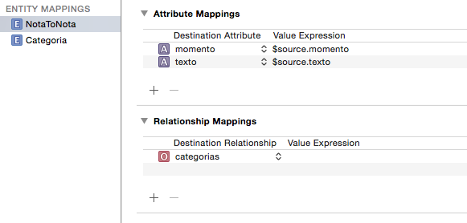
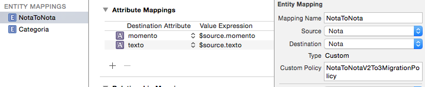

Hay muchos cambios que Core Data no puede deducir automáticamente. Por ejemplo, si queremos dividir un atributo en dos, calcular el valor de un atributo nuevo a partir de otros, o convertir un atributo en una entidad. En estos casos tenemos que especificar nosotros cómo transformar los datos del modelo antiguo al nuevo.

## El ejemplo

Supongamos que en nuestra app de mensajería cada `Usuario` tenía un atributo `departamento` de tipo `String`, con el nombre del departamento de la empresa al que pertenece. Nos hemos dado cuenta de que no es buena idea: el nombre de cada departamento se repite en todos sus usuarios, si alguien lo escribe de forma ligeramente distinta tendremos dos departamentos diferentes, y no podemos guardar más información sobre los departamentos. Sería mejor tener una entidad `Departamento` aparte, con un atributo `nombre`, y una relación "uno a muchos" entre `Departamento` y `Usuario`.

Así, en la nueva versión del modelo:

- Creamos la entidad `Departamento`, con un atributo `nombre` de tipo `String`.
- Eliminamos el atributo `departamento` de `Usuario`, y en su lugar creamos una relación `departamento` "a uno" de `Usuario` a `Departamento`, con su inversa `usuarios` "a muchos".

Core Data no tiene forma de saber que hay que crear un `Departamento` por cada nombre distinto que aparezca en los usuarios, y asociarle los usuarios correspondientes. Esto lo tendremos que hacer nosotros.

## Cómo funciona una migración manual

En una migración manual Core Data abre la base de datos antigua, crea una nueva vacía con el nuevo modelo, y va recorriendo los objetos antiguos creando a partir de ellos los objetos nuevos. Las reglas para crear los objetos nuevos a partir de los antiguos se definen en un ***mapping model***. Para los casos que no se puedan expresar en el *mapping model*, escribiremos código en una clase llamada ***migration policy***.

A diferencia de las ligeras, estas migraciones cargan los objetos en memoria, por lo que son mucho más lentas y consumen más recursos. Con muchos datos, la app debería mostrar al usuario algún indicador de que se está realizando la operación.

## 1. Crear la nueva versión del modelo

Como siempre, guardamos un punto de restauración, creamos una nueva versión del modelo, hacemos en ella los cambios y la marcamos como versión actual.

## 2. Crear el *mapping model*

En `File > New > File...` seleccionamos la plantilla `Mapping Model` (en la sección `Core Data`). El asistente nos preguntará cuál es la versión de origen del modelo, cuál la de destino, y el nombre del nuevo archivo `.xcmappingmodel`.

Si abrimos el archivo creado, veremos que Xcode ha intentado deducir la correspondencia entre las dos versiones.



A la izquierda están los ***entity mappings***, que indican cómo crear los objetos de cada entidad nueva a partir de los de la antigua. Normalmente se llaman con el nombre de la entidad antigua y la nueva, por ejemplo `UsuarioToUsuario`. Para cada uno, a la derecha vemos los ***attribute mappings*** y los ***relationship mappings***, con una expresión que indica de dónde sacar el valor de cada atributo o relación. Por ejemplo, `$source.login` indica que el valor del atributo `login` del nuevo usuario se copiará del atributo `login` del usuario origen (`$source`).

Normalmente Xcode deduce bien la mayoría de correspondencias, pero **hay que revisarlas**. En nuestro ejemplo, en el *entity mapping* `UsuarioToUsuario`, la relación `departamento` debe quedar **sin expresión** (*Value Expression* vacía), ya que la estableceremos por código.

> El *mapping model* está ligado a las dos versiones concretas del modelo que elegimos al crearlo. **Si después modificamos la versión de destino, el *mapping model* deja de ser válido** y Core Data no lo encontrará al migrar. En ese caso hay que volver a seleccionar la versión de destino en el inspector del *mapping model*, o crearlo de nuevo.

## 3. Crear la *migration policy*

La creación de los objetos nuevos a partir de los antiguos la hace la clase `NSEntityMigrationPolicy`. Para personalizarla, creamos una clase que herede de ella y sobreescribimos el método `createDestinationInstances(forSource:in:manager:)`, que se llama una vez por cada objeto antiguo de la entidad.

La forma más sencilla de hacerlo es llamar primero a la implementación de `super`, que crea el objeto nuevo y le copia los atributos según el *mapping model*, y después completarlo con lo que haga falta:

```swift
import CoreData

class DepartamentosMigrationPolicy: NSEntityMigrationPolicy {
    //Departamentos ya creados, por nombre, para no crear dos con el mismo nombre
    private var departamentos: [String: NSManagedObject] = [:]

    override func createDestinationInstances(forSource sInstance: NSManagedObject,
                                             in mapping: NSEntityMapping,
                                             manager: NSMigrationManager) throws {
        //1. Core Data crea el usuario nuevo y copia los atributos según el mapping model
        try super.createDestinationInstances(forSource: sInstance, in: mapping, manager: manager)

        //2. Obtenemos el usuario nuevo que se acaba de crear
        guard let usuarioDestino = manager.destinationInstances(forEntityMappingName: mapping.name,
                                                                sourceInstances: [sInstance]).first
        else { return }

        //3. Leemos el antiguo atributo "departamento" del usuario origen
        guard let nombreDpto = sInstance.value(forKey: "departamento") as? String,
              !nombreDpto.isEmpty
        else { return }

        //4. Buscamos el departamento entre los ya creados, o lo creamos si es el primero
        let departamento: NSManagedObject
        if let existente = departamentos[nombreDpto] {
            departamento = existente
        } else {
            departamento = NSEntityDescription.insertNewObject(forEntityName: "Departamento",
                                                               into: manager.destinationContext)
            departamento.setValue(nombreDpto, forKey: "nombre")
            departamentos[nombreDpto] = departamento
        }

        //5. Asociamos el usuario nuevo con su departamento
        usuarioDestino.setValue(departamento, forKey: "departamento")
    }
}
```

!!! warning "Durante la migración no se usan las clases de las entidades"
    Fíjate en que no usamos la clase `Usuario`, sino `NSManagedObject` y los métodos `value(forKey:)` y `setValue(_:forKey:)`. La clase `Usuario` que genera Xcode corresponde a la versión **actual** del modelo, en la que ya no existe el atributo `departamento` como `String`, así que no nos serviría para leer los datos antiguos. Durante una migración, los objetos de origen siguen la versión antigua del modelo y los de destino la nueva, y la única forma segura de acceder a sus propiedades es por su nombre.

Una vez creada la clase, hay que indicar en el *mapping model* que el *entity mapping* `UsuarioToUsuario` debe usarla. Lo seleccionamos y en el panel de la derecha escribimos el nombre de la clase en el campo `Custom Policy`, **precedido del nombre del módulo**, que normalmente es el nombre del proyecto: `Mensajeria.DepartamentosMigrationPolicy`.



> Si olvidamos el nombre del módulo, Core Data no encontrará la clase y la migración fallará. Si el nombre del proyecto tiene espacios o guiones, en el nombre del módulo se sustituyen por guiones bajos.

## 4. Ejecutar la migración

Y ya está: no hay que cambiar el código del `PersistenceController`. Al arrancar, Core Data detectará que la base de datos se creó con una versión anterior del modelo, buscará en la app un *mapping model* para pasar de esa versión a la actual y, si lo encuentra, lo usará. Solo si no encuentra ninguno intentará hacer una migración ligera.

> Si queremos asegurarnos de que se usa nuestro *mapping model* y no una migración ligera (por ejemplo, porque hemos modificado el modelo de destino y el *mapping model* ha dejado de ser válido sin que nos demos cuenta), podemos desactivar temporalmente la inferencia automática en el inicializador del `PersistenceController`, antes de `loadPersistentStores`:
>
> ```swift
> container.persistentStoreDescriptions.first?.shouldInferMappingModelAutomatically = false
> ```
>
> Así, si Core Data no encuentra el *mapping model*, `loadPersistentStores` dará un error en lugar de intentar una migración ligera.

Gracias al punto de restauración, podemos ejecutar la migración, comprobar el resultado, corregir lo que haga falta y repetirla tantas veces como necesitemos.

## Saltos de versión

!!! info "Nota"
    Este apartado es de ampliación.

Core Data no encadena migraciones automáticamente. Si un usuario tiene instalada la versión 1 de nuestra app y se salta la 2, al instalar la 3 Core Data necesitará migrar directamente de la versión 1 del modelo a la 3. Si existe un *mapping model* de la 1 a la 2 y otro de la 2 a la 3, no los aplicará uno detrás de otro: necesitaremos un *mapping model* de la 1 a la 3, o bien escribir nosotros el código que haga las migraciones paso a paso. Es algo a tener en cuenta en una app publicada que tenga varias versiones del modelo.
