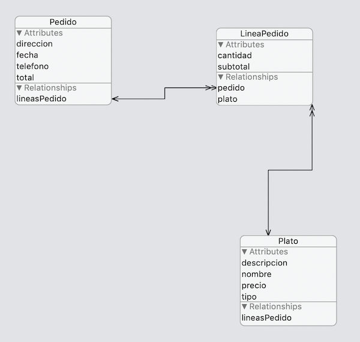

# Miniproyecto: *app* restaurante (2.5 puntos en total)

El objetivo es desarrollar una pequeña aplicación para gestionar pedidos *online* a un restaurante. Almacenaremos en Core Data los datos de la carta y de los pedidos realizados por el usuario, y usaremos buena parte de lo que hemos visto en el bloque: modelo de datos, consultas con secciones y búsqueda, relaciones, concurrencia...

Descárgate la plantilla de la aplicación desde Moodle. En ella está ya implementada la interfaz de usuario: tú tienes que implementar las funcionalidades relacionadas con Core Data. La plantilla compila y se puede ejecutar desde el principio: verás las tres pestañas de la app (la carta, el pedido actual y el historial de pedidos) con datos de ejemplo, que irás sustituyendo por los datos reales.

Estos son los archivos de la plantilla:

| Archivo | Contenido |
|---|---|
| `RestauranteApp.swift` | Estructura principal. Al arrancar llama a la importación de los platos |
| `Persistence.swift` | El `PersistenceController`, como en la plantilla de Xcode |
| `ContentView.swift` | El `TabView` con las tres pestañas |
| `Util/ImportadorPlatos.swift` | Lee los platos del JSON y los importa en Core Data |
| `Carta/CartaView.swift` y `Carta/FilaPlato.swift` | La carta y cada una de sus filas |
| `Pedido/PedidoActualView.swift` | La pestaña del pedido actual |
| `Pedido/FormularioPedido.swift` y `Pedido/FilaLinea.swift` | El formulario con las líneas del pedido, el total y los datos de entrega, y cada una de sus líneas |
| `Historial/HistorialView.swift` | El historial de pedidos |
| `platos.json` | Los datos de los platos de la carta |

En el código encontrarás comentarios `//TODO:` donde tienes que añadir código.

> Las filas de la carta (`FilaPlato`) y del pedido (`FilaLinea`) ya están hechas. No reciben objetos de Core Data sino datos simples (nombre, precio, cantidad...) y una clausura con la acción a ejecutar al pulsar el botón "Añadir" o al cambiar la cantidad. Así compilan aunque todavía no hayas creado el modelo de datos.

## El modelo de datos (0.5 puntos)

**En el proyecto abre el fichero `Restaurante.xcdatamodeld` y crea el siguiente modelo de datos**

Nuestro modelo de datos debe tener tres entidades, `Plato`, `Pedido` y `LineaPedido`. Esta última es la que relaciona los platos con los pedidos, guardando cuántas unidades de un plato se han incluido en un pedido. 

> En la figura, las flechas dobles representan relaciones "a muchos" y las flechas simples "a uno"



!!! info "Consejos"
    - Crea primero todas las entidades y después las relaciones, si no no podrás especificar la entidad destino de cada relación
    - Las relaciones por defecto se crean "a uno", recuerda modificar esto en el panel derecho de Xcode si es necesario

Cada entidad debe tener las siguientes propiedades y relaciones

- `Plato`:
    + Propiedades:
        * `nombre` de tipo `String`
        * `descripcion` de tipo `String`
        * `precio` de tipo `Double`
        * `tipo` de tipo `String`
    + Relaciones:
        * `lineasPedido`, relación "a muchos" con destino `LineaPedido`. La inversa es la relación `plato`
- `Pedido`:
    + Propiedades:
        *  `direccion` de tipo `String`
        *  `fecha` de tipo `Date`
        *  `telefono` de tipo `String`
    +  Relaciones:
        *  `lineasPedido`, relación "a muchos" con destino `LineaPedido`. La inversa es la relación `pedido`. En la regla de borrado (*delete rule*) pon `Cascade` para que al eliminar un pedido se eliminen automáticamente sus líneas.
-  `LineaPedido`:
    +  Propiedades
        *  `cantidad` de tipo `Integer 16`
    +  Relaciones
        *  `pedido`, relación "a uno" con destino `Pedido`. La inversa es la relación `lineasPedido`
        *  `plato`, relación "a uno" con destino `Plato`. La inversa es la relación `lineasPedido`

**Deja todos los atributos como opcionales**. En particular, la fecha de un pedido tiene que poder ser `nil`, ya que la usaremos para distinguir el pedido que el usuario está haciendo en este momento (todavía sin fecha) de los ya realizados (ver el apartado del pedido actual).

**Elige tú la *delete rule* de la relación `lineasPedido` de `Plato`**: ¿qué debería ocurrir con las líneas de pedido de un plato si el restaurante lo quita de la carta? En la entrega, indica qué regla has elegido y justifícalo brevemente.

!!! info "Simplificaciones"
    Deberíamos usar tipos `Decimal` en los precios para evitar errores de redondeo, pero usaremos `Double` por simplicidad, ya que `Decimal` no se acepta directamente en Core Data y tendríamos que usar un *transformable*. Además, el tipo del plato debería ser un enumerado, pero estos tampoco se pueden almacenar directamente en Core Data.

## Inicializar los datos (0.25 puntos)

Un problema habitual en Core Data es cómo rellenar inicialmente la base de datos. Un enfoque muy habitual es incluir en el proyecto un archivo con los datos en algún formato estándar (JSON, CSV, YAML,...) y copiarlos a Core Data la primera vez que se ejecuta la app. Es lo que haremos aquí.

Los datos de los platos del restaurante están en el archivo `platos.json`. En `Util/ImportadorPlatos.swift`, la función `importarSiHaceFalta`, que se llama al arrancar la app, lee el JSON y lo almacena en un array de `structs` de tipo `DatosPlato`. Para que la importación se haga solo la primera vez, usa una preferencia de usuario llamada `platosImportados`: si está a `true`, no se importa nada.

**Añade el código que copie los datos de los `structs` a entidades `Plato` en Core Data**, donde está el comentario `//TODO`. Las propiedades de `DatosPlato` tienen los mismos nombres y tipos que en la entidad `Plato`.

- La importación debe hacerse **en un contexto en segundo plano**, como vimos en la sesión de concurrencia. Con los pocos platos de este ejemplo no se notaría, pero una carta real podría tener muchos más datos, y no queremos bloquear la interfaz al arrancar la app.
- Cuando hayas implementado la importación, **descomenta la línea que pone la preferencia `platosImportados` a `true`**. Está comentada para que no se marquen los platos como importados antes de que la importación funcione.

Tras esto, con la ayuda de la aplicación SimSim puedes echarle un vistazo a la base de datos de SQLite creada por Core Data para ver si están los registros. En SimSim selecciona la app `Restaurante` y luego la opción `Terminal` para abrir una terminal en la carpeta de la *app* en el simulador. Para ver la base de datos SQLite puedes hacer en esta terminal:

```bash
cd "Library/Application Support"
sqlite3 Restaurante.sqlite
##Debería aparecer el prompt de sqlite -> "sqlite>"
##Con esta orden puedes ver la estructura de la BD
.schema
##Las tablas tendrán el mismo nombre que las entidades de Core Data con una "Z" delante
##Por tanto puedes ver los platos con
select * from ZPLATO;
##Puedes salir de sqlite con .quit
```

Para forzar la recarga de los datos tendrás que borrar las preferencias y la base de datos. Lo más sencillo es borrar la app del simulador (mantener pulsado el icono > `Eliminar app`), o usar la opción `Reset Application Data` de SimSim.

## La carta (0.5 puntos)

Esta parte de la *app* es la que muestra los platos y nos permite añadirlos al pedido. Está en `CartaView`.

### Listado de platos

**Muestra los platos de la carta agrupados en secciones según su tipo**, con el tipo como título de cada sección y, dentro de cada sección, los platos ordenados alfabéticamente. Para cada plato usa una `FilaPlato`, y borra la sección de ejemplo.

Por ahora, en la acción de "Añadir" de cada fila basta con un `print` del nombre del plato.

!!! info "Ayuda"
    Repasa la sección "Consultas en las vistas" de la sesión de consultas, en particular el apartado sobre secciones.

### Búsqueda de platos

**Implementa la búsqueda de platos**: la barra de búsqueda ya está en la vista, conectada a la variable `textoBusqueda`. Deben mostrarse los platos cuyo nombre **o** descripción contenga el texto buscado, sin distinguir mayúsculas/minúsculas ni acentos. Si el texto está vacío, deben mostrarse todos los platos.

Comprueba que las secciones se actualizan correctamente al buscar: si buscas "queso", solo deben aparecer las secciones que tengan algún plato que lo contenga.

Opcionalmente, puedes retardar la búsqueda para que no se lance en cada pulsación de tecla, como hiciste en la aplicación de notas.

## El pedido actual (0.75 puntos)

### El pedido actual en la base de datos

En la versión de UIKit de esta práctica, el pedido que el usuario está haciendo en cada momento (el "pedido actual") se guardaba en memoria. Esto tiene un problema: si el usuario cierra la app mientras está haciendo el pedido, lo pierde.

Aquí lo haremos de otra forma: **el pedido actual es el `Pedido` que no tiene fecha**. Mientras el usuario va añadiendo platos, el pedido está guardado en Core Data sin fecha; al realizarlo, le pondremos la fecha y pasará a ser un pedido realizado. Así, el pedido actual se conserva aunque se cierre la app, y para encontrarlo basta con una consulta: el pedido cuya fecha es `nil`.

### Añadir un plato al pedido

Escribe en `CartaView` una función que reciba un `Plato` y lo añada al pedido actual, y llámala desde la acción del botón "Añadir" de cada fila:

- Busca el pedido actual. Si no hay ninguno (porque es el primer plato que se añade, o porque el anterior pedido ya se realizó), **créalo**.
- Si el plato **ya está** en el pedido actual, incrementa en 1 la cantidad de su línea de pedido.
- Si no, **crea una nueva `LineaPedido`** con cantidad 1, y asóciala con el plato y con el pedido.
- **Guarda el contexto**.

### Mostrar el pedido actual

La pestaña del pedido actual tiene dos vistas:

- `PedidoActualView` es la pestaña en sí. Debe consultar el pedido actual (el `Pedido` sin fecha) y, si existe, mostrar un `FormularioPedido` con él. Si no existe, debe mostrar la vista `pedidoVacio`, que ya está hecha.
- `FormularioPedido` recibe el pedido y muestra sus líneas, el total y los datos de entrega. Debe consultar las líneas de ese pedido, ordenadas alfabéticamente por el nombre del plato, y mostrar una `FilaLinea` por cada una (borra la de ejemplo). **Calcula también el total** del pedido en la propiedad `total`.

!!! info "Ayuda"
    Para `FormularioPedido` tendrás que crear la consulta en el inicializador, como se explica en el apartado "Consultas que dependen de un parámetro" de la sesión de consultas. Además del pedido, el inicializador tendrá que recibir el *binding* del mensaje, y asignarlo a `_mensaje`. Al cambiar el inicializador, la `#Preview` de `FormularioPedido` dejará de compilar: bórrala (o, si quieres, crea un pedido de ejemplo en `PersistenceController.preview` y adáptala para usarlo).

    Al crear el `FormularioPedido` en `PedidoActualView`, añádele el modificador `.id(pedido.objectID)`. Así, cuando se realice un pedido y se cree otro nuevo, SwiftUI lo tratará como una vista distinta y empezará con los datos de entrega vacíos.

Comprueba que si añades platos en la carta y cambias a la pestaña "Tu pedido", aparecen, sin que hayas tenido que escribir código para actualizar la lista.

!!! warning "¿Por qué dos vistas?"
    Podría parecer más sencillo hacer una sola vista que consultara directamente las líneas del pedido actual, con el predicado `pedido.fecha == nil`. Pero no funcionaría bien: una `@FetchRequest` solo se entera de los cambios en los objetos de **su entidad**. Al realizar el pedido cambia la fecha del `Pedido`, pero las `LineaPedido` no cambian, así que la consulta de líneas no se volvería a evaluar y las líneas seguirían en pantalla. En cambio, una consulta de pedidos sí se entera de que el pedido ha cambiado de fecha.

### Cambiar la cantidad de un plato

Cuando el usuario cambia la cantidad con el `Stepper` de una fila, se ejecuta la clausura que se le pasa a `FilaLinea` con la nueva cantidad. **Actualiza la cantidad de la línea de pedido correspondiente y guarda el contexto**. El total debe actualizarse automáticamente.

> Para simplificar, la cantidad solo se puede mover entre 1 y 100: no se puede bajar a 0 para eliminar el plato.

### Realizar y cancelar el pedido

- Al pulsar "Realizar pedido", asigna al pedido la dirección, el teléfono y la fecha actual, y guarda el contexto. Como el pedido ya tiene fecha, deja de ser el pedido actual, y en la pestaña debe aparecer la vista de pedido vacío con el mensaje "¡Tu pedido está en camino!". El siguiente plato que se añada creará un pedido nuevo.
- Al pulsar "Cancelar pedido", borra el pedido actual de Core Data y guarda el contexto. Si la regla de borrado en cascada está puesta correctamente, al borrar un pedido deberían borrarse automáticamente todas sus líneas.

Comprueba que si añades platos al pedido, detienes la app y la vuelves a ejecutar, el pedido actual sigue ahí.

## El historial (0.5 puntos)

En la pestaña "Historial" se deben mostrar los pedidos realizados por el usuario, del más reciente al más antiguo. Está en `HistorialView`, y puedes diseñar la interfaz como desees.

- **(0.25 puntos)** Muestra una fila por cada pedido realizado, con su fecha, el importe total y el número de platos pedidos (sumando las cantidades de todas las líneas). Para calcular el total y el número de platos, escribe dos propiedades calculadas `total` y `numPlatos` en una extensión de la clase `Pedido`.
- **(0.25 puntos)** Al pulsar sobre un pedido, se debe navegar a una pantalla de detalle que muestre sus líneas (plato, cantidad e importe de cada una), la dirección y el teléfono.

Comprueba que, al realizar un pedido, aparece inmediatamente en el historial, y que los pedidos cancelados no aparecen.
