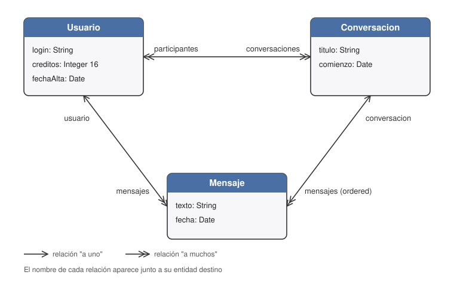

El **modelo de datos** sería más o menos el equivalente al esquema entidad/relación en una base de datos relacional. Con la diferencia de que en Core Data tenemos clases Swift y variables miembro en lugar de tablas y claves ajenas. 

Normalmente en una aplicación hay un solo modelo de datos, que se almacena en un archivo `.xcdatamodeld`. Al crear el proyecto eligiendo `Core Data` en el desplegable `Storage`, Xcode nos crea un modelo con el mismo nombre del proyecto (con una entidad de ejemplo, `Item`, que normalmente eliminaremos), que editaremos con el editor visual de Xcode.

> Hasta Xcode 13 el editor tenía, además del modo "tabla", un modo "gráfico" (*Graph*) que mostraba un diagrama con las entidades y sus relaciones. **Desde Xcode 14 el modo gráfico ya no existe** y todo se edita en modo tabla. Los diagramas de estos apuntes sirven para entender los modelos, pero no los verás así en Xcode.

## El ejemplo de esta sesión

Para explicar los conceptos de la sesión vamos a ir construyendo paso a paso el modelo de datos de una aplicación de mensajería sencilla, con tres entidades:

- `Usuario`: cada usuario tiene un `login` único, un número de `creditos` y una fecha de alta (`fechaAlta`).
- `Mensaje`: tiene un `texto` y una `fecha`. Cada mensaje lo envía un usuario y pertenece a una conversación.
- `Conversacion`: tiene un `titulo` y una fecha de `comienzo`. Una conversación tiene muchos mensajes (en un orden determinado) y muchos participantes, y un usuario puede participar en muchas conversaciones.



## Entidades

Las entidades comparten ciertas características con las clases de la POO y otras con las tablas de una base de datos. Como las clases, pueden heredar unas de otras o ser *abstractas*. Como las tablas, tienen relaciones con otras entidades (uno-a-uno, uno-a-muchos,...) y se puede especificar qué debe pasar cuando uno de los "lados" de la relación se elimina.

Para crear las tres entidades del ejemplo pulsamos el botón `Add Entity` de la parte inferior del editor y le cambiamos el nombre a cada una con doble clic. Recuerda que **el nombre de una entidad debe comenzar por mayúscula**.

Si seleccionamos una entidad podemos ver sus características en el `Data Model Inspector` (`Cmd+Alt+4` o *clic* en el cuarto icono del panel de la derecha de Xcode). Las más importantes son:

- `Class`: el nombre de la clase Swift que representará a la entidad y cómo se genera su código. Lo veremos en la siguiente sección.
- `Constraints`: restricciones de valores únicos, que veremos en este mismo apartado.
- `Abstract Entity` y `Parent Entity`: para la herencia entre entidades. No la usaremos en el ejemplo.

> Con el almacenamiento SQLite, todas las entidades de una misma jerarquía de herencia se guardan en **una única tabla**, que tiene columnas para los atributos de todas ellas. Si la jerarquía es grande esto puede afectar al rendimiento, así que conviene no abusar de la herencia entre entidades.

## Atributos

Seleccionada una entidad, añadimos atributos con el `+` de la sección `Attributes`. Para cada uno indicamos el nombre (**que debe comenzar por minúscula**) y el tipo. Para el `Usuario` crearemos:

| Atributo | Tipo |
|---|---|
| `login` | `String` |
| `creditos` | `Integer 16` |
| `fechaAlta` | `Date` |

Los tipos disponibles son los habituales: enteros de distintos tamaños, reales, `Decimal`, `String`, `Boolean`, `Date`, `UUID`, `URI`, y dos especiales, `Binary Data` y `Transformable`, para guardar datos binarios u objetos de otras clases (se explican en el apéndice de ampliación).

Seleccionando un atributo, en el `Data Model Inspector` podemos fijar sus características. Las más importantes son:

- `Optional`: si está marcado, el atributo puede quedarse sin valor (`nil`). Es el contrario del típico "not null" de las bases de datos. Por defecto los atributos nuevos son opcionales. En el ejemplo desmarcaremos `Optional` en `login` y `fechaAlta`, ya que todo usuario debe tenerlos.
- `Default Value`: valor que se asignará automáticamente si no le damos uno. Pondremos `0` en `creditos`.
- **Reglas de validación**: valor mínimo y máximo (números y fechas), longitud mínima y máxima (cadenas) o una expresión regular (`Reg. Ex.`). En `creditos` pondremos un mínimo de `0`. Veremos cómo se comportan en la sección de validaciones.

> Hay que distinguir entre un atributo opcional en una entidad y una variable opcional en Swift. Que un atributo de una entidad sea no opcional significa que **en el momento de guardar el objeto en el almacenamiento persistente éste debe tener un valor no nulo** pero en memoria puede haber un intervalo de tiempo mientras vamos "rellenando" las propiedades en que sea `nil`. Por eso las clases que genera Xcode declaran los atributos de tipo objeto (`String`, `Date`...) como opcionales de Swift aunque en el modelo no lo sean.

De forma similar crearíamos los atributos de `Mensaje` (`texto` de tipo `String` y `fecha` de tipo `Date`, ambos no opcionales) y de `Conversacion` (`titulo` de tipo `String` y `comienzo` de tipo `Date`).

## Relaciones

Las relaciones vinculan una entidad con otra. Para crearlas, seleccionamos la entidad origen y pulsamos el `+` de la sección `Relationships`. En la tabla hay tres características directamente editables:

- **Nombre**: debe comenzar por minúscula. Por convenio se le pone el nombre de la entidad destino, en singular si es una relación "a uno" y en plural si es "a muchos". Así, la relación de `Mensaje` a `Usuario` se llamará `usuario` y la de `Usuario` a `Mensaje`, `mensajes`.
- **Destino** (`Destination`): la entidad vinculada.
- **Inversa** (`Inverse`): la relación que va en sentido contrario. En el ejemplo, la inversa de `usuario` es `mensajes` y viceversa.

**Todas las relaciones deberían tener inversa**: Core Data la usa para mantener la consistencia del grafo de objetos (por ejemplo, para actualizar automáticamente un lado de la relación cuando cambiamos el otro, o cuando se borran objetos). Xcode muestra un *warning* si una relación no la tiene. Para establecerla, primero hay que crear las dos relaciones, cada una en su entidad, y luego elegir la inversa en el desplegable de cualquiera de ellas; Xcode rellenará la de la otra.

Seleccionando una relación, en el `Data Model Inspector` podemos configurar:

- `Type`: `To One` o `To Many`. Una relación uno a muchos es una relación `To Many` cuya inversa es `To One`. Las relaciones muchos a muchos se consiguen poniendo las dos con el tipo `To Many`.
- `Optional`: igual que en los atributos.
- `Ordered` (solo en relaciones `To Many`): si el orden de los objetos relacionados importa. No es lo mismo el orden de los mensajes de una conversación que el de las conversaciones de un usuario.
- `Count Minimum` y `Count Maximum` (solo en relaciones `To Many`): cardinalidad mínima y máxima. Vacío significa sin límite.
- `Delete Rule`: qué ocurre con los objetos relacionados cuando se borra el objeto origen de la relación:
    - `Nullify` (la opción por defecto): los objetos relacionados se quedan, y su relación inversa se pone a `nil`
    - `Cascade`: los objetos relacionados se borran también
    - `Deny`: no se puede borrar el objeto mientras tenga objetos relacionados (dará error al guardar)
    - `No Action`: no se hace nada, la inversa queda apuntando a un objeto que ya no existe (!). Prácticamente nunca se usa.

Con todo esto, las relaciones del modelo de mensajería serían:

| Entidad | Relación | Destino | Tipo | Inversa | Delete Rule |
|---|---|---|---|---|---|
| `Usuario` | `mensajes` | `Mensaje` | To Many | `usuario` | Deny |
| `Mensaje` | `usuario` | `Usuario` | To One | `mensajes` | Nullify |
| `Conversacion` | `mensajes` | `Mensaje` | To Many, Ordered | `conversacion` | Cascade |
| `Mensaje` | `conversacion` | `Conversacion` | To One | `mensajes` | Nullify |
| `Usuario` | `conversaciones` | `Conversacion` | To Many | `participantes` | Nullify |
| `Conversacion` | `participantes` | `Usuario` | To Many | `conversaciones` | Nullify |

Fíjate en las *delete rules*, que reflejan decisiones sobre cómo debe comportarse la aplicación:

- Si se borra una conversación, sus mensajes no tienen sentido por sí solos, así que se borran con ella (`Cascade`).
- No queremos que se pueda borrar un usuario que tiene mensajes, porque las conversaciones quedarían con mensajes "huérfanos" de autor (`Deny`). Habría que borrar o reasignar antes sus mensajes.
- Si un usuario se borra (porque no tiene mensajes), simplemente deja de aparecer como participante en sus conversaciones (`Nullify`).

Otras decisiones serían igualmente válidas: lo importante es pensar qué tiene sentido en cada caso.

## Restricciones de valores únicos

Las restricciones o *constraints* nos permiten especificar uno o más atributos que no pueden repetir valores, es decir la típica restricción *unique* de las bases de datos relacionales. En el ejemplo, no puede haber dos usuarios con el mismo `login`.

Para añadir una restricción, seleccionamos la entidad y en el recuadro `Constraints` del `Data Model Inspector`:

1. Pulsar sobre `+`. Aparecerá una línea que pone `comma,separated,properties`, indicando que aquí podemos teclear una lista de atributos separados por comas
2. Hacer doble clic sobre esa línea para hacerla editable
3. Escribir el atributo (`login`) o la lista de atributos. Si ponemos varios, lo que no se puede repetir es la combinación de valores.

La restricción se comprueba en el momento de guardar el contexto. ¿Qué pasa si estamos guardando un usuario con un `login` que ya existe? Depende de la *merge policy* (política de mezcla) del contexto:

- Por defecto la política es `NSErrorMergePolicy`: `save()` lanza un error y no se guarda nada. Es lo adecuado en nuestro ejemplo, ya que dos personas distintas no pueden tener el mismo `login`: hay que avisar al usuario para que elija otro. Veremos cómo tratar el error en la sección de CRUD.
- Con `NSMergePolicy.mergeByPropertyObjectTrump`, en lugar de dar error los dos objetos se fusionan en uno solo, y los valores del objeto que estamos guardando "machacan" a los que había en el almacén. Es útil por ejemplo cuando descargamos datos de un servidor y queremos que si un objeto ya existía se actualice en lugar de duplicarse. También existe la política inversa, `mergeByPropertyStoreTrump`, en la que prevalecen los valores ya almacenados.

Si queremos cambiar la política, se hace por código. Con la plantilla generada por Xcode podemos hacerlo en el inicializador del `PersistenceController` (archivo `Persistence.swift`), justo después de cargar los *stores*:

```swift
init(inMemory: Bool = false) {
    container = NSPersistentContainer(name: "Mensajeria")
    //...código generado por Xcode
    container.loadPersistentStores(completionHandler: { (storeDescription, error) in
        //...código generado por Xcode
    })
    container.viewContext.automaticallyMergesChangesFromParent = true
    //AÑADIMOS esta línea
    container.viewContext.mergePolicy = NSMergePolicy.mergeByPropertyObjectTrump
}
```

Se puede consultar la documentación de [`NSMergePolicy`](https://developer.apple.com/documentation/coredata/nsmergepolicy) para más información.
