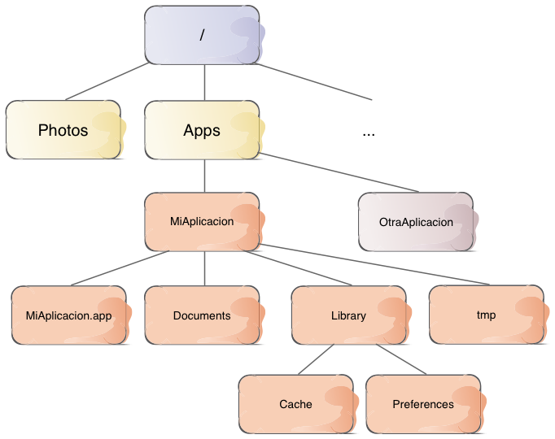

!!! info "Ejercicio"
    Al final de esta sección hay un "mini-ejercicio" puntuado con **0.25 puntos** del total de **1.5 puntos** de todos los ejercicios de hoy.

## Introducción

En iOS el sistema de archivos del dispositivo no es visible al completo para una aplicación cualquiera por motivos de seguridad. iOS en realidad es un sistema UNIX por lo que el disco tiene la típica estructura de directorios de estos sistemas. No obstante, cada aplicación está contenida en lo que se denomina un *sandbox*, es decir un conjunto de directorios del que "no puede salirse" y fuera del que no puede acceder a ninguna información del disco. A la inversa otras aplicaciones tampoco pueden acceder al *sandbox* de nuestra aplicación.

> Ojo: el simulador **no** aplica el *sandbox*. Una app que se ejecuta en el simulador podría escribir fuera de sus directorios sin que se produzca ningún error, pero en un dispositivo real fallará. Que algo funcione en el simulador no garantiza que funcione en el dispositivo.

El *sandbox* tiene una estructura de directorios estandarizada, donde cada directorio tiene un papel específico reservado en la aplicación. Nuestra aplicación puede crear y modificar libremente archivos y directorios, aunque siempre debería respetar el papel que el sistema le asigna a cada directorio.

Primero veremos cuál es la estructura “estándar” del *sandbox* y luego el API para abrir, crear y modificar archivos y directorios.

## El sistema de archivos de cada aplicación

Cuando se instala una aplicación en un dispositivo iOS el sistema crea una estructura de directorios como la que aparece en la siguiente figura.



Los directorios más importantes son los siguientes:

- *nombre_de_la_aplicacion*`.app/`: aunque por la extensión podría parecer que es un archivo se trata de un directorio, que contiene lo que se denomina el *bundle* de la aplicación: el ejecutable, los iconos, imágenes, sonidos, etc. **Es de solo lectura**: la aplicación no puede modificar nada de su interior. En realidad no está dentro del contenedor de datos, sino en otra ubicación del disco, aunque conceptualmente forme parte de la app.
- `Documents/`: es el directorio reservado para el contenido creado por el usuario. Si por ejemplo nuestra aplicación es un editor de textos, aquí es donde deberíamos almacenarlos. iOS incluye este directorio en las copias de seguridad.
- `Library/`: no suele contener directamente archivos sino subdirectorios. Los más importantes son:
    - `Caches/`: donde almacenamos los datos que se pueden volver a recrear sin problemas si es necesario. Por ejemplo índices de datos de nuestra aplicación que sirvan para hacer las búsquedas más rápidas. Por ello iOS no hace copia de seguridad de este directorio cuando hacemos un *backup* del dispositivo. Además, el sistema puede borrar su contenido si se queda sin espacio en disco, por lo que nuestra app nunca debe dar por hecho que lo que guardó aquí sigue existiendo.
    - `Preferences/`: las preferencias de configuración de la aplicación, que posteriormente veremos con más detalle. No debemos escribir directamente en este directorio, sino a través del API de preferencias (`UserDefaults`).
    - `Application Support/`: contenido generado por la aplicación pero que no ha sido creado directamente por el usuario (por ejemplo, una base de datos). A diferencia de los anteriores, **este directorio no existe por defecto**: la aplicación tiene que crearlo la primera vez que lo necesite (más adelante veremos cómo).
- `tmp/`: como puede deducirse está indicado para archivos y directorios temporales, de los que iOS tampoco hará copia de seguridad. El sistema puede vaciarlo cuando la app no se está ejecutando, aunque es responsabilidad nuestra borrar los archivos cuando ya no los necesitemos.

### Paths y URLs

Antes de poder realizar cualquier operación sobre un archivo o directorio, tenemos primero que *localizarlo* en el sistema de archivos, es decir, encontrar su *path* absoluto - desde la raíz del sistema de archivos. Aunque en iOS no podemos “salirnos fuera” del *sandbox* este paso sigue siendo necesario. 

En iOS podemos dar cualquier trayectoria de un archivo de dos formas distintas: como *path* local (un `String`) o como URLs, que uniformizan el tratamiento de las rutas y nos permiten también especificar la localización de recursos remotos. Los nombres de los métodos en ambos casos suelen ser iguales, salvo que los que trabajan con *paths* generalmente acaban en `Path` y los que trabajan con URLs en `URL`.

> Apple recomienda usar URLs en lugar de *paths*, ya que uniformizan el tratamiento de los recursos, sean locales o no.

La clase básica que se usa para interactuar con el sistema de archivos es el `FileManager`. No es necesario crear una instancia, podemos obtener la instancia por defecto con `FileManager.default`

### El *bundle* de la aplicación

Acceder al directorio con el *bundle* de la aplicación (el `.app`) es sencillo:

```swift
let bundleURL = Bundle.main.bundleURL
```

Las imágenes del catálogo de *assets* que usamos con `Image("...")` en SwiftUI también van dentro del *bundle*, compiladas en un único archivo.

Con `bundlePath` en lugar de `bundleURL` podemos obtener también el *path* en forma local (sin el `file://` delante).

### Los directorios “típicos”

Para obtener la URL de un directorio del *sandbox* se usa el método `urls(for:in:)`, de la clase `FileManager`. Al método le pasamos un par de constantes:

- La clase de directorio que estamos buscando, como un valor enumerado del tipo `FileManager.SearchPathDirectory` (por ejemplo para `Library/` el valor es `libraryDirectory`, para `Documents` es `documentDirectory`, para `Caches` es `cachesDirectory` y para `Application Support` es `applicationSupportDirectory`). Se puede consultar la [lista completa](https://developer.apple.com/documentation/foundation/filemanager/searchpathdirectory), aunque la mayoría de valores solo tienen sentido en macOS.
- El "dominio" o ámbito de la búsqueda, un valor enumerado del tipo `FileManager.SearchPathDomainMask`. En iOS siempre usaremos el valor `userDomainMask`, que en macOS indica el directorio del usuario, pero en iOS en realidad se refiere al ámbito de la aplicación actual. 

Por ejemplo, así obtendríamos la URL del directorio `Documents` de la aplicación actual:

```swift
let urls = FileManager.default.urls(for: .documentDirectory, in: .userDomainMask)
//Nótese que el método devuelve un array de URLs
//Casi siempre nos interesa solo la primera
if let docDir = urls.first {
    print("El directorio 'Documents' es \(docDir)")
}
else {
    print("error al buscar el directorio 'Documents'")
}
```

Si ejecutamos el código anterior en un dispositivo real nos aparecerá una URL del estilo `file:///var/mobile/Containers/Data/Application/id_de_la_aplicacion/Documents`.

En el simulador la URL será similar pero la primera parte de la trayectoria cambia ya que se refiere a donde se está ejecutando la app dentro del simulador, algo como `file:///Users/[nombre_usuario]/Library/Developer/CoreSimulator/Devices/[id_del_dispositivo]/data/Containers/Data/Application/[id_de_la_aplicacion]/Documents/`. Para complicar un poco más el asunto, el identificador de la app puede cambiar cada vez que la reinstalamos (y Xcode la reinstala cada vez que la ejecutamos). Los datos se conservan, pero la ruta cambia.

!!! warning "No guardes rutas absolutas"
    Como la ruta del contenedor puede cambiar entre ejecuciones (también en el dispositivo, por ejemplo al actualizar la app o restaurar una copia de seguridad), **nunca debemos almacenar la ruta absoluta de un archivo** (en preferencias, en una base de datos...). Guardaremos solo el nombre o la ruta relativa y calcularemos la URL completa en cada ejecución.

> En el simulador, el sistema de carpetas y archivos de cada *app* se guarda en un directorio un poco "perdido" en el disco y difícil de localizar manualmente. Hay aplicaciones que nos permiten encontrarlo más fácilmente para así poder depurar la app viendo su *sandbox*. Una de estas aplicaciones, de libre distribución, es [SimSim](https://github.com/dsmelov/simsim). Recomendamos su uso para poder depurar las aplicaciones viendo cómo se crean los datos. En el ejercicio al final de la sección se describe brevemente su uso.

#### A partir de iOS 16: propiedades estáticas de `URL`

Desde iOS 16 (Xcode 14 o superior) la clase `URL` tiene propiedades estáticas que simplifican mucho el código anterior: `URL.documentsDirectory`, `URL.libraryDirectory`, `URL.cachesDirectory`, `URL.applicationSupportDirectory` y `URL.temporaryDirectory`. Por ejemplo:

```swift
let docDir = URL.documentsDirectory
let fileURL = docDir.appending(path: "prueba.txt")
```

El método `appending(path:)` es la versión moderna de `appendingPathComponent(_:)`, que veremos en muchos ejemplos y que sigue funcionando. Ambas formas son válidas si el *deployment target* del proyecto es iOS 16 o superior (en Xcode 15 los proyectos nuevos se crean con iOS 17 por defecto). En estos apuntes usaremos sobre todo la forma clásica con `FileManager`, porque es la que encontraréis en la mayoría de documentación y código existente.

#### Crear el directorio `Application Support`

Como hemos dicho, este directorio no existe inicialmente. Para obtener su URL y que se cree si no existe podemos usar el método `url(for:in:appropriateFor:create:)`:

```swift
let appSupport = try FileManager.default.url(for: .applicationSupportDirectory,
                                             in: .userDomainMask,
                                             appropriateFor: nil,
                                             create: true)
```

### El directorio temporal

Podemos obtener la URL del directorio para archivos temporales con la propiedad `temporaryDirectory` del *file manager*

```swift
let tmpDir = FileManager.default.temporaryDirectory
print("Dir. archivos temporales: \(tmpDir)")
```

## Operaciones con archivos y directorios

> La mayoría de métodos de esta sección pueden generar errores (lanzan excepciones), por eso van precedidos de `try`. En los ejemplos usamos a menudo `try!` por brevedad, pero en una app real deberíamos usar `do`/`catch`, ya que si se produce un error con `try!` la app se cerrará.

### Listar el contenido de un directorio

Sabiendo la URL de un determinado directorio podemos listar sus contenidos con el método `contentsOfDirectory(at:includingPropertiesForKeys:options:)`

El siguiente ejemplo toma el directorio donde está el *bundle* de la aplicación y lista sus contenidos, mostrando para cada elemento la fecha de creación y si es o no un directorio. 

```swift
let urlBundle = Bundle.main.bundleURL
let contenidos = try! FileManager.default.contentsOfDirectory(at: urlBundle, 
              includingPropertiesForKeys: [.creationDateKey, .isDirectoryKey], 
              options: .skipsHiddenFiles)
print("Hay \(contenidos.count) elementos")
for url in contenidos {
    print(url.lastPathComponent, terminator:"")
    let rv = try! url.resourceValues(forKeys: [.creationDateKey, .isDirectoryKey])
    print(" \(rv.creationDate!)", terminator:"")
    if rv.isDirectory! {
        print(" (DIR)")
    }
    else  {
       print("")
    }
}
```

- El parámetro `includingPropertiesForKeys` es un array de constantes del tipo `URLResourceKey` donde especificamos la "meta-información" a obtener para cada item (por ejemplo tamaño, fecha de creación, si es o no un directorio, etc).
- `options` puede ser un conjunto vacío (`[]`) o bien `.skipsHiddenFiles` para indicar que no queremos obtener los archivos o directorios ocultos.

Una vez obtenemos los items con `contentsOfDirectory`, mostramos sus datos, incluyendo la información obtenida. La "meta-información" sobre el archivo/directorio se obtiene con el método de `URL` llamado `resourceValues`. Este nos devuelve un objeto `URLResourceValues` con propiedades que se corresponden con los datos de la "meta-información"

Una versión simplificada del listado de directorios nos la da el método `contentsOfDirectory(atPath:)` que trabaja a partir de un *path* en forma de `String` y no permite obtener propiedades de los items, solo nos devuelve un array de `String` con los nombres.

```swift
let pathBundle = Bundle.main.bundlePath
let contenidos = try! FileManager.default.contentsOfDirectory(atPath: pathBundle)
for nombre in contenidos {
    print(nombre)
}
```

### Operaciones con archivos y directorios: copiar, mover, borrar

Básicamente tenemos disponibles estas operaciones a través de métodos del `FileManager`. Como venimos diciendo, por defecto se recomienda usar *URLs*. Si usamos *paths* en su lugar, generalmente el método se llamará igual pero los parámetros serán los acabados en *Path*. En general también se puede operar indistintamente sobre archivos o directorios. Así por ejemplo podemos:

- comprobar si existe un item con `fileExists(atPath:)` (para una URL `u`, usaríamos `fileExists(atPath: u.path)`)
- copiar un item (archivo o directorio) en otro con `copyItem(at:to:)` o `copyItem(atPath:toPath:)`
- mover un item con `moveItem(at:to:)` o `moveItem(atPath:toPath:)`
- eliminar un item con `removeItem(at:)` o `removeItem(atPath:)`
- crear un directorio con `createDirectory(at:withIntermediateDirectories:attributes:)`

Se recomienda consultar la documentación del [API de FileManager](https://developer.apple.com/documentation/foundation/filemanager) para más detalles sobre estas y otras operaciones.

## Ejercicio de la sección (0.25 puntos)

El objetivo del ejercicio es simplemente "echarle un vistazo" al *sandbox* de una aplicación. Como hemos dicho, en el simulador el *sandbox* de una *app* se guarda en un subdirectorio "un poco perdido" dentro del disco del Mac. Para comprobar en fase de desarrollo si la app está guardando bien los datos necesitamos tener acceso a este *sandbox*. La herramienta *SimSim* nos permite acceder a él de forma sencilla.

1. **Bájate el [.zip con la app](https://github.com/dsmelov/simsim/blob/master/Release/SimSim_latest.zip?raw=true) SimSim**, descomprímelo y arrástralo a la carpeta de `Aplicaciones` del Mac. Como no es una app de la Mac App Store, la primera vez que la abras macOS te avisará de que no puede verificar el desarrollador: ábrela con botón derecho > `Abrir` (o autorízala en `Ajustes del Sistema > Privacidad y seguridad`).
2. **Ejecuta la aplicación SimSim**. En la barra superior del Mac aparecerá un icono con esta forma . Si lo pulsas verás una lista con las *apps* móviles que hayas simulado recientemente. Si eliges una de ellas verás un submenú con varias opciones, entre ellas:
    - `Finder` abre una ventana del administrador de archivos en el *sandbox* de la *app* simulada
    - `Terminal` hace lo mismo pero con una terminal 
3. **Abre una ventana del Finder** en alguna *app* simulada de las que aparezcan en el menú de SimSim (no importa cuál). Comprueba que la estructura de directorios se corresponde con la del *sandbox* típico de una *app* iOS. Haz un volcado de pantalla de la ventana del Finder e inclúyelo en la entrega de ejercicios como parte de la respuesta a este ejercicio.
4. **Crea un nuevo proyecto de Xcode, llamado PruebaArchivos** (plantilla `iOS > App`, con `Interface: SwiftUI`). Sustituye el contenido de `ContentView.swift` por el siguiente código. Al pulsar el botón, se escribe un mensaje de texto dentro de un fichero "prueba.txt" en el `Documents` del *sandbox*
```swift
import SwiftUI

struct ContentView: View {
    @State private var mensaje = ""

    var body: some View {
        VStack(spacing: 20) {
            Button("Escribir archivo") {
                escribirArchivo()
            }
            .buttonStyle(.borderedProminent)
            Text(mensaje)
        }
        .padding()
    }

    func escribirArchivo() {
        let file = "prueba.txt"  //nombre del archivo
        let text = "hola iOS"    //texto que escribiremos en él

        //obtenemos la URL del directorio Documents
        if let dir = FileManager.default.urls(for: .documentDirectory, in: .userDomainMask).first {
            //le añadimos detrás el "/prueba.txt"
            let fileURL = dir.appendingPathComponent(file)
            //guardamos el String en el archivo
            do {
                try text.write(to: fileURL, atomically: true, encoding: .utf8)
                mensaje = "Archivo guardado"
            } catch {
                mensaje = "Error: \(error.localizedDescription)"
            }
        }
    }
}

#Preview {
    ContentView()
}
```
5. **Ejecuta la app PruebaArchivos en el simulador**, pulsa el botón y con la aplicación SimSim comprueba visualmente que el archivo "prueba.txt" se ha creado correctamente, ábrelo haciendo doble clic y comprueba su contenido. Haz un volcado de pantalla de la ventana del Finder donde se vea que el archivo existe, e inclúyelo en la entrega de ejercicios como parte de la respuesta a este ejercicio.

!!! tip "Si SimSim no funciona en tu Mac"
    SimSim es una herramienta de terceros que lleva tiempo sin actualizarse. Si no te funciona, puedes abrir el *sandbox* de la app desde la Terminal con `simctl`, que viene con Xcode. Con el simulador arrancado y la app instalada, escribe (cambiando el identificador por el *bundle identifier* de tu app, que aparece en la pestaña `General` del *target*):

    ```bash
    open "$(xcrun simctl get_app_container booted es.ua.mastermoviles.PruebaArchivos data)"
    ```

    Otra opción es imprimir con `print` la URL de `Documents` desde la app, copiarla de la consola de Xcode y en el Finder usar `Ir > Ir a la carpeta...` (`Shift+Cmd+G`), pegando la ruta sin el `file://` inicial.
