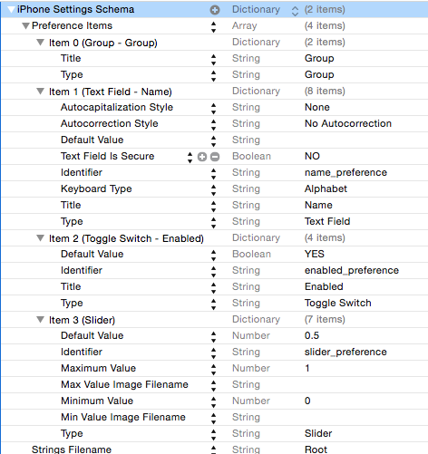
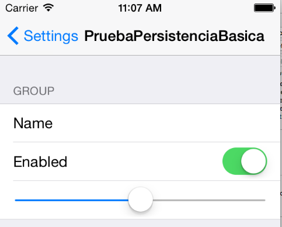

!!! info "Ejercicio"
    Al final de esta sección hay un ejercicio puntuado con **0.75 puntos** del total de **1.5 puntos** de todos los ejercicios de hoy.


## Preferencias de usuario

En la mayoría de las aplicaciones podemos configurar una serie de parámetros que las adaptan a las preferencias o necesidades del usuario. Son elementos tales como colores, tipos de fuentes, unidades de medida, el nombre de usuario de un servicio de terceros, etc.

> Las contraseñas, *tokens* de acceso y en general cualquier dato sensible **no** deben guardarse en las preferencias, ya que se almacenan en un `.plist` sin cifrar dentro del *sandbox*. Para eso iOS dispone del *Keychain* (llavero), que queda fuera del alcance de esta sesión.

iOS nos ofrece un mecanismo estándar para almacenar estas preferencias de modo permanente. El API es bastante sencillo y nos permite establecer unos valores por defecto, modificarlos según lo que indique el usuario y leer los valores previamente fijados. 

Hay que destacar que iOS solo nos da el API para leer/almacenar las preferencias, pero no la interfaz de usuario para mostrarlas/modificarlas, que es nuestra responsabilidad (aunque, como veremos, en SwiftUI conectar una preferencia a un control es muy sencillo). Hay una excepción: si queremos que nuestras preferencias aparezcan dentro de la app `Ajustes` del sistema, el propio iOS se encargará de la interfaz.

### Qué se puede guardar en las preferencias

Desde el punto de vista del tipo de datos, las preferencias de usuario no son más que una *property list* en la que el objeto “raíz” es un diccionario. Por tanto, solo podemos guardar los tipos de datos que admiten las *property lists* (`String`, números, `Bool`, `Date`, `Data`, y arrays y diccionarios de estos). El sistema se encarga de serializar/deserializar los valores a/desde un archivo `.plist` de modo automático.

Si usamos este API nos ahorraremos tener que gestionar manualmente el `.plist` como hacíamos en la sección anterior. No tenemos que crearlo nosotros, comprobar si existe, guardarlo cuando toque o recuperar los datos cuando hagan falta, iOS lo hará por nosotros.

> El sistema carga en memoria todas las preferencias al arrancar la app, por lo que este mecanismo es adecuado solo para datos pequeños. No es el sitio para guardar grandes cantidades de información (imágenes, listados largos...).

El fichero `.plist` con las preferencias se almacena automáticamente en el directorio `Library/Preferences` de la aplicación. Su nombre es el *bundle identifier* de la app, que por defecto es el "organization identifier" del proyecto seguido del nombre del producto (por ejemplo `es.ua.mastermoviles.PersistenciaBasica.plist`).

Por defecto el `.plist` se genera en formato binario. Aunque no esté en modo texto podemos igualmente abrirlo y editarlo con el editor de .plist de Xcode. También podemos convertirlo a XML con una herramienta en línea de comandos llamada `plutil`, incluida en macOS:

```bash
plutil -convert xml1 -o resultado_xml.plist fichero_original.plist
```

O simplemente ver su contenido en la terminal con `plutil -p fichero.plist`.

### Acceder a las preferencias<a name="acceso_prefs"></a>

Las preferencias del usuario actual son accesibles a través del *singleton* de la clase `UserDefaults`. Para acceder a la instancia compartida, usamos la propiedad estática `standard`:

```swift
let preferencias = UserDefaults.standard
```

> También veréis código que hace `UserDefaults()`. Esto crea una instancia nueva (no el *singleton*) que en la práctica accede a los mismos datos, así que funciona, pero la forma recomendada es `UserDefaults.standard`.

> Como las aplicaciones iOS están en un *sandbox* cada una solo tiene acceso a sus propias preferencias. El propio sistema no puede cambiar las preferencias de nuestra aplicación, salvo las que coloquemos dentro de los ajustes generales, como veremos más adelante.

Dentro del almacén de preferencias cada una de ellas tiene una clave, que será una cadena, y un valor. Así, podemos acceder a una preferencia con una familia de métodos `xxx(forKey:)`, donde la "xxx" varía según el tipo de datos: `string`, `integer`, `bool`, `float`, `double`, `array`, `dictionary`, `data`, `object`,…

Por ejemplo, supongamos un juego en el que tuviéramos almacenado el *nick* del usuario y el *nivel* alcanzado. Podríamos obtener los valores con:

```swift
let nick = preferencias.string(forKey: "nick")
let nivel = preferencias.integer(forKey: "nivel")
```

Al leer los valores de las preferencias se plantea un problema: cómo saber si ya tenemos un valor almacenado en las preferencias o no. En ciertos tipos de datos esto es sencillo: en un `String` como la preferencia *nick*, de no haber ya algo almacenado con esa clave se obtendrá `nil`. Pero con otros tipos no es tan fácil, ya que en el caso del *nivel* si la preferencia no existía se obtendrá 0 (y con `bool(forKey:)`, `false`). Entonces ¿cómo diferenciar si la preferencia se ha fijado a 0 o bien es que no se ha fijado? Una posibilidad es usar `object(forKey:)`, que sí devuelve `nil` si la clave no existe. Pero la solución más habitual es registrar *valores por defecto* para todas las preferencias, de modo que no pueda haber una preferencia con un valor no fijado, bien sea porque se ha hecho por defecto o bien sea porque lo ha hecho una acción del usuario.

### Registrar valores por defecto

Podemos registrar un conjunto de preferencias por defecto pasándole un diccionario al método `register(defaults:)` de `UserDefaults`:

```swift
let prefs = UserDefaults.standard
prefs.register(defaults: [
  "nick" : "anonimo",
  "nivel" : 1
])
```

Hay que destacar que *los valores registrados por defecto no son permanentes*, no se guardan en el `.plist`. Es decir, que hay que registrarlos cada vez que arranque la aplicación. En una app SwiftUI el sitio habitual es el inicializador de la estructura principal de la app, la marcada con `@main`, que se ejecuta al arrancar:

```swift
@main
struct MiJuegoApp: App {
    init() {
        UserDefaults.standard.register(defaults: [
            "nick" : "anonimo",
            "nivel" : 1
        ])
    }

    var body: some Scene {
        WindowGroup {
            ContentView()
        }
    }
}
```

Si registramos un valor por defecto y este ya ha sido fijado por código (en la siguiente sección veremos cómo) el valor por defecto no “machacará” al ya fijado. Cuando iOS busca el valor para una preferencia sigue un esquema de “dominios”, en el que si no encuentra la clave en un dominio la busca en el siguiente. De este modo, primero busca en el dominio de los valores fijados por la aplicación y si lo encuentra aquí lo devuelve. Es solo si no lo encuentra aquí cuando pasa a consultar los valores por defecto.

Es un poco tedioso tener que volcar en el código un diccionario con todos los valores por defecto. Un método muy habitual de registrar los valores por defecto de modo más “limpio” es almacenarlos en un archivo `.plist` del *bundle* cuya raíz sea un diccionario. Como `register(defaults:)` necesita un diccionario `[String: Any]` y no un `struct`, en lugar del `PropertyListDecoder` usaremos la clase `PropertyListSerialization`, que convierte la *plist* en diccionarios y arrays genéricos:

```swift
if let url = Bundle.main.url(forResource: "PreferenciasPorDefecto", withExtension: "plist"),
   let data = try? Data(contentsOf: url),
   let dic = try? PropertyListSerialization.propertyList(from: data, format: nil) as? [String: Any] {
    UserDefaults.standard.register(defaults: dic)
}
```

### Modificar los valores de las preferencias <a name="modificar_prefs"></a>

Simplemente tenemos que fijar la clave al valor que queramos usando la familia de métodos `set(_:forKey:)`

```swift
let prefs = UserDefaults.standard
prefs.set(5, forKey: "nivel")
prefs.set("Pepito", forKey: "nick")
```

Para eliminar una preferencia (y que vuelva a tomar su valor por defecto, si lo hay) usamos `removeObject(forKey:)`.

Los cambios se aplican inmediatamente en memoria (si leemos la preferencia justo después obtendremos el nuevo valor), pero el sistema los escribe en el `.plist` de forma asíncrona, poco después. No tenemos que hacer nada para que se guarden.

> En código antiguo veréis llamadas al método `synchronize()` para "forzar" la escritura en disco. Apple indica en la documentación que este método es innecesario y que no debe usarse. 

Lo que sí hay que tener en cuenta al **probar** la aplicación es que si la detenemos con el botón *stop* de Xcode justo después de cambiar una preferencia, puede que el cambio no haya llegado a escribirse, porque Xcode "mata" el proceso. Para asegurarnos, antes de detenerla salimos al *home* (`Shift+Cmd+H` en el simulador, o el menú `Device > Home`) para que la app pase a *background*.

> Fijar una preferencia es una operación barata, así que podemos hacerlo en el momento en que el usuario cambie el valor. **No** es buena idea retrasarlo hasta justo antes de salir de la aplicación, ya que el sistema puede terminar nuestra app sin avisar y perderíamos los cambios.

### Preferencias en SwiftUI: `@AppStorage`<a name="appstorage"></a>

Todo lo anterior funciona igual en cualquier app iOS. Pero en SwiftUI tenemos además una forma mucho más cómoda de trabajar con preferencias: el *property wrapper* `@AppStorage`. Se usa como `@State`, pero en lugar de guardar el valor en la memoria de la vista lo guarda en las preferencias de usuario, con la clave que le indiquemos:

```swift
struct AjustesView: View {
    @AppStorage("nick") private var nick = "anonimo"
    @AppStorage("sonido") private var sonido = true

    var body: some View {
        VStack {
            TextField("Nick", text: $nick)
            Toggle("Sonido", isOn: $sonido)
        }
        .padding()
    }
}
```

Al leer la propiedad `nick` se lee la preferencia `"nick"`, y al modificarla (en este caso, al escribir en el `TextField`) se guarda. No hay que escribir código para cargar ni para guardar. Además, igual que con `@State`, cuando la preferencia cambia la vista se redibuja.

Algunas cosas a tener en cuenta:

- El valor que asignamos en la declaración (`"anonimo"`, `true`) es el que se usa si la preferencia no tiene ningún valor guardado. Si usamos la misma clave en varias vistas, conviene que el valor por defecto sea el mismo en todas, o mejor, registrarlo con `register(defaults:)` como hemos visto antes.
- Es la misma preferencia que si la usáramos con el API de `UserDefaults`: `@AppStorage("nick")` y `UserDefaults.standard.string(forKey: "nick")` acceden al mismo valor, en el mismo `.plist`.
- Solo admite algunos tipos: `Bool`, `Int`, `Double`, `String`, `URL`, `Data`, y enumeraciones cuyo valor asociado (`rawValue`) sea `Int` o `String`. **No admite directamente `Date` ni arrays.** Para estos tipos usaremos el API de `UserDefaults` o los convertiremos a uno de los admitidos.
- Es ideal para **ajustes ligados a un control** (un interruptor, un tamaño de letra, un tema de color...), que se guardan en cuanto el usuario los cambia. Si queremos guardar un dato en un momento concreto (por ejemplo, al pulsar un botón "Guardar"), suele quedar más claro usar directamente el API de `UserDefaults`.

### Material complementario: ubicar las preferencias en los ajustes del sistema

!!! info "Nota"
    Este apartado no te servirá para los ejercicios pero puedes echarle un vistazo para saber algo más del tema

El sistema nos da la posibilidad de controlar ciertas preferencias de nuestra aplicación dentro de la app `Ajustes`, en un apartado reservado a ella. Esto es lo que se conoce en iOS como un *settings bundle*. Podemos colocar aquí todas las preferencias o solo algunas.

> Apple recomienda colocar en los ajustes del sistema solo las preferencias que se cambien en raras ocasiones, por ejemplo el servidor al que se conecta la app o activar un modo de depuración.

A diferencia de las preferencias dentro de la aplicación, donde iOS nos da un API para editarlas/verlas pero no una interfaz, aquí es al contrario. En un fichero `.plist` con un formato especial podemos crear de modo sencillo una interfaz para las preferencias. 

Para crear un *settings bundle* en Xcode ir a `File > New > File...` y en el cuadro de diálogo que aparecerá, dentro del tipo `Resource` elegir `Settings Bundle`. Se creará un archivo de tipo *property list* llamado `Root.plist` y algunos archivos auxiliares para la internacionalización (necesarios ya que vamos a tratar con elementos de interfaz).

Si editamos el `Root.plist` con el editor de Xcode podemos ver que tiene un formato un tanto especial: la lista de preferencias se representa con un array de items. Las propiedades de estos items son las que determinan el tipo de *widget* a usar para editar/ver la preferencia, sus parámetros y la clave con la que se va a almacenar la preferencia asociada. 

En el ejemplo que se muestra a continuación, que se corresponde con el `Root.plist` que crea por defecto Xcode, puede verse que el item 1 es de tipo "campo de texto", que su `title` (la etiqueta que se ve en las preferencias) es `Name`, que el *widget* tiene una serie de propiedades (cuando se edita aparece un teclado alfabético, no es seguro - o sea, se muestra el contenido, …) y está asociada a la preferencia cuya clave es `name_preference` (propiedad `Identifier`). 





> Los valores por defecto (`DefaultValue`) que pongamos en el `Root.plist` solo los usa la app `Ajustes` para mostrarlos. Nuestra app no los "ve" hasta que el usuario los cambia, así que igualmente tendremos que registrarlos con `register(defaults:)`.

> En iOS 17 (el del simulador de Xcode 15) los ajustes de la app aparecen al final de la lista principal de `Ajustes`. A partir de iOS 18 se han movido a `Ajustes > Apps`.

No tenemos espacio en estos apuntes para explicar más detalladamente el proceso de configuración del *bundle*. El lector interesado puede consultar el apartado “[Implementing an iOS Settings Bundle](https://developer.apple.com/library/archive/documentation/Cocoa/Conceptual/UserDefaults/Preferences/Preferences.html)” de la “[Preferences and Settings Programming Guide](https://developer.apple.com/library/archive/documentation/Cocoa/Conceptual/UserDefaults/Introduction/Introduction.html)” de Apple. Es documentación antigua (archivada), pero sigue siendo válida en lo esencial.


## Ejercicio (0.75 puntos)

Vamos a realizar una pequeña aplicación en la que los datos se guarden usando las preferencias de usuario. Consistirá en una única pantalla con un área de texto para editar un mensaje, la fecha y hora en que se guardó, y un botón para guardarlo. Los datos deben conservarse aunque salgamos de la aplicación.

Crea un proyecto llamado `PersistenciaBasica` (plantilla `iOS > App`, `Interface: SwiftUI`).

### La interfaz

Sustituye el contenido de `ContentView.swift` por este esqueleto:

```swift
import SwiftUI

struct ContentView: View {
    @State private var texto = ""
    @State private var fechaEdicion: Date?

    var body: some View {
        VStack(alignment: .leading, spacing: 16) {
            //área de texto de varias líneas
            TextEditor(text: $texto)
                .border(.secondary)

            //fecha y hora de la última vez que se guardó
            if let fecha = fechaEdicion {
                Text("Guardado: \(fecha.formatted(date: .abbreviated, time: .standard))")
                    .foregroundStyle(.secondary)
            } else {
                Text("Sin guardar")
                    .foregroundStyle(.secondary)
            }

            Button("Guardar") {
                //AQUÍ irá el código para guardar
            }
            .buttonStyle(.borderedProminent)
        }
        .padding()
    }
}

#Preview {
    ContentView()
}
```

> `TextEditor` es la versión de varias líneas de `TextField`. Igual que este, se conecta a una variable de estado mediante un *binding* (`$texto`).

> `formatted(date:time:)` convierte la fecha en texto según el idioma y la región del dispositivo. Fíjate en que la fecha la guardamos como `Date` y solo la convertimos a texto para mostrarla.

Comprueba en la preview o en el simulador que puedes escribir en el área de texto.

### Guardar los datos (0.25 puntos)

En la acción del botón "Guardar":

- Pon `fechaEdicion` a la fecha y hora actuales (`Date()`). Como es una variable de estado, el texto con la fecha se actualizará solo.
- Guarda el texto y la fecha como dos preferencias de usuario llamadas "texto" y "fecha" respectivamente, usando el API de `UserDefaults` (apartado "[Modificar los valores de las preferencias](#modificar_prefs)"). Guarda la fecha como `Date`, no convertida a texto.

### Recuperar los datos al arrancar (0.25 puntos)

Cuando aparezca la pantalla, recupera las dos preferencias y asígnalas a `texto` y `fechaEdicion`. Para ejecutar código cuando aparece una vista, se usa el modificador `.onAppear`, el equivalente en SwiftUI al `viewDidLoad`/`viewWillAppear` de UIKit. Añádelo al `VStack`:

```swift
VStack(alignment: .leading, spacing: 16) {
    //...
}
.padding()
.onAppear {
    //AQUÍ el código para recuperar las preferencias
}
```

Consulta el apartado ["Acceder a las preferencias"](#acceso_prefs). Para recuperar la fecha, como no hay un método específico para fechas, tendrás que usar `object(forKey:)` y convertir el resultado a `Date` con un *cast* condicional (`as? Date`). Ten en cuenta que **la primera vez que se ejecuta la app todavía no hay nada guardado** y `object(forKey:)` devolverá `nil`. Como `fechaEdicion` es opcional, puedes asignarle directamente el resultado del *cast*: si no hay nada guardado, quedará a `nil` y se mostrará "Sin guardar".

Para comprobar si las preferencias se guardan:

-  Escribe algo y pulsa "Guardar".
-  Sal de la _app_ como lo haría un usuario en el móvil real (menú `Device > Home` del simulador). 
-  Ve a la aplicación SimSim en el menú superior, selecciona la app `PersistenciaBasica` y luego selecciona `Finder`: se abrirá una carpeta con el sistema de archivos de la *app*. 
-  Las preferencias se guardan en `Library/Preferences`. Debería haber un fichero `.plist`. Si lo abres dándole doble clic debería abrirse en Xcode y podrás ver el contenido.
-  Detén la app en Xcode y vuelve a ejecutarla: deberían aparecer el texto y la fecha guardados.

### Tamaño de letra con `@AppStorage` (0.25 puntos)

Vamos a permitir que el usuario elija el tamaño de letra del área de texto. El tamaño elegido es una preferencia típica, que debe conservarse entre ejecuciones, pero esta vez usaremos `@AppStorage` (apartado "[Preferencias en SwiftUI](#appstorage)").

- Declara en `ContentView` una propiedad `tamanoLetra` de tipo `Double`, con `@AppStorage`, y con un valor por defecto de 17.
- Añade debajo del botón un `Stepper`, un control con dos botones para aumentar y disminuir un valor, que modifique el tamaño entre 12 y 30 puntos:

```swift
Stepper("Tamaño de letra: \(Int(tamanoLetra))", value: $tamanoLetra, in: 12...30)
```

- Aplica el tamaño al área de texto con el modificador `.font(.system(size: tamanoLetra))`.

Fíjate en que esta vez no has tenido que escribir código para guardar ni para recuperar la preferencia. Comprueba que el tamaño se conserva al detener la app y volver a ejecutarla, y que en el `.plist` de las preferencias aparece la nueva clave.

Para terminar, prueba a declarar `fechaEdicion` con `@AppStorage` en lugar de `@State`. ¿Qué ocurre? En la entrega, explica en dos o tres líneas por qué, y cómo podrías guardar la fecha si quisieras usar `@AppStorage` (no hace falta que lo implementes). Después deja el código como estaba.
